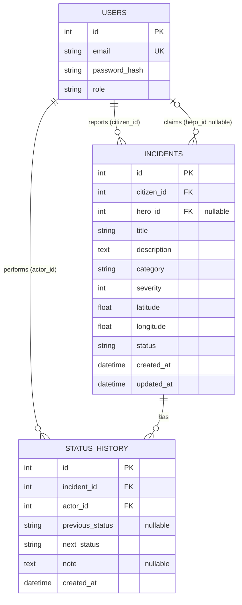

# Spider-Sense — Incident Reporting API

A local FastAPI backend for reporting emergencies, letting Heroes claim available incidents, and recording an audit trail of incident status changes. Three roles are implemented: **Citizen**, **Hero**, and **Command**. This is a learning/demo backend, not a production emergency dispatch service.

## Stack and prerequisites

- Python 3.14 (the environment used for the reported test run); a compatible Python 3 installation is required.
- macOS Terminal, Python `venv`, pip
- FastAPI, Uvicorn, SQLAlchemy, SQLite, Pydantic, PyJWT, pwdlib
- SQLite database file is created locally; no separate database server is required.

**Expected project layout** (the supplied archive contains these source files at its root; place the application modules inside `app/` and the test module inside `tests/`):

```text
SpiderSenseFromScratch/
├── app/
│   ├── __init__.py
│   ├── main.py
│   ├── database.py
│   ├── models.py
│   ├── schemas.py
│   └── security.py
├── tests/
│   └── test_api.py
├── seed_heroes.py
├── seed_command.py
├── requirements.txt
├── er-diagram.mmd
└── README.md
```

## macOS setup

Run from the project root (the directory containing `app/` and `requirements.txt`):

```bash
python3 -m venv .venv
source .venv/bin/activate
python -m pip install -r requirements.txt
python -m pip install pytest httpx
```

`pytest` and `httpx` are needed for the tests but are **not included** in the supplied `requirements.txt`. To make installation reproducible, add them to a development requirements file in the future.

Set the JWT signing secret **before importing or running the app**:

```bash
export SPIDER_SENSE_JWT_SECRET="$(python -c 'import secrets; print(secrets.token_urlsafe(32))')"
```

This variable is required: `app/security.py` reads it when imported. Keep it private, never commit it, and use a stable securely stored value in any persistent deployment. Tokens signed with a different secret will no longer verify. Tokens expire after 30 minutes; signing algorithm is HS256.

Initialize the SQLite tables (the inspected `main.py` does not create them automatically):

```bash
python -c "from app.database import Base, engine; import app.models; Base.metadata.create_all(bind=engine)"
```

Start the server:

```bash
python -m uvicorn app.main:app --reload
```

Open the interactive API documentation at **http://127.0.0.1:8000/docs**. Health check: **http://127.0.0.1:8000/health**.

> The database URL is hard-coded as `sqlite:///./spider_sense.db`, so start commands from the project root. The SQLite file contains application data; do not commit it or share it with real personal data.

## Environment variables

| Variable | Required | Purpose |
|---|---|---|
| `SPIDER_SENSE_JWT_SECRET` | Yes | Signs/verifies JWTs; do not expose or commit |

No database URL environment-variable override is implemented in the inspected code.

## API routes

All routes except `/health`, `/auth/register`, and `/auth/login` require `Authorization: Bearer <access_token>`.

| Method | Path | Role | Purpose |
|---|---|---|---|
| GET | `/health` | Public | Health check |
| POST | `/auth/register` | Public | Register a **Citizen** (201) |
| POST | `/auth/login` | Public | Get bearer JWT |
| GET | `/auth/me` | Any authenticated user | Current user |
| POST | `/incidents` | Citizen | Report incident (201) |
| GET | `/incidents` | Citizen | List **own** incidents; filters and pagination |
| GET | `/incidents/{incident_id}` | Citizen | View **own** incident |
| GET | `/hero/incidents` | Hero | List **reported/unclaimed** incidents |
| POST | `/hero/incidents/{incident_id}/claim` | Hero | Claim reported incident |
| PATCH | `/hero/incidents/{incident_id}/status` | Claiming Hero | Advance status |
| GET | `/hero/incidents/{incident_id}/history` | Claiming Hero | View status history |
| GET | `/command/incidents` | Command | List incidents across Citizens |
| GET | `/command/incidents/{incident_id}/history` | Command | View incident history |

**List query parameters** for Citizen and Command: `status`, `category`, `severity` (1–5), `page` (default 1), `page_size` (default 10; maximum 100). List response includes `total`, `page`, `page_size`, `total_pages`, `items`. Hero discovery is a simple list, not a paginated response.

**Incident creation JSON:**

```json
{
  "title": "Building Fire",
  "description": "A fire has started inside a residential building.",
  "category": "Fire",
  "severity": 5,
  "latitude": 21.1458,
  "longitude": 79.0882
}
```

Severity is an integer 1–5. Latitude must be -90 to 90; longitude -180 to 180.

**Status update JSON:** `{"status": "in_progress", "note": "Responder on site"}` or `{"status": "resolved", "note": "Issue addressed"}`. The `note` is optional (maximum 500 characters).

## Role permissions

| Operation | Citizen | Hero | Command |
|---|:---:|:---:|:---:|
| Register via public endpoint (creates Citizen) | Yes | — | — |
| Create incident | Yes | No | No |
| List/view own incidents | Yes | No | No |
| View reported incidents for claiming | No | Yes | No |
| Claim an available incident | No | Yes | No |
| Update claimed incident | No | Only assigned Hero | No |
| View Hero incident history | No | Only assigned Hero | No |
| View all incidents and their history via Command endpoints | No | No | Yes |

Hero accounts are provisioned with `seed_heroes.py`; Command accounts with `seed_command.py`. **Public registration never grants elevated roles.** The supplied Hero seed script includes demo credentials; change them before any shared or nonlocal use. Command is **read-only** in the inspected API: there is no Command assignment endpoint.

## Database ER diagram

The editable source is [`er-diagram.mmd`](er-diagram.mmd). The diagram reflects the SQLAlchemy model fields and foreign keys.



`users.id` is referenced by both `incidents.citizen_id` and `incidents.hero_id`; `status_history.actor_id` references `users.id`. Foreign keys are enabled in SQLite connection setup.

## Incident lifecycle

```text
reported --[Hero claim]--> claimed --[assigned Hero]--> in_progress --[assigned Hero]--> resolved
```

A second claim returns **409 Conflict**; skipping `in_progress` also returns **409**. Claim and status transitions create `status_history` records with actor, previous/next status, optional note, and timestamp. Only the claiming Hero can update or view the Hero history endpoint.

## Automated tests

Run from the project root with the virtual environment activated and `SPIDER_SENSE_JWT_SECRET` set:

```bash
python -m pytest tests/test_api.py -q
```

**Actual reported result (30 October 2026):**

```text
.......... [100%]
10 passed, 1 warning in 2.25s
```

The warning was `StarletteDeprecationWarning` concerning `httpx`/`starlette.testclient`. The 10 tests cover authentication, role restrictions, Citizen ownership, Hero claiming, duplicate-claim rejection, invalid status transitions, full lifecycle/history, invalid severity, combined filters/pagination, and Citizen isolation. **Command authorization is implemented but not covered by these 10 tests.**

Tests use `spider_sense_test.db`, reset tables via a pytest fixture, and override the FastAPI database dependency.

## Interview demo (Swagger UI)

1. **Show the ER diagram.** Explain `users`, `incidents`, and `status_history` and their foreign keys.
2. **Register a Citizen** using `POST /auth/register`; then log in using `POST /auth/login`. In Swagger, click **Authorize** and supply the Citizen JWT.
3. **Create an incident** with `POST /incidents`, then show it under `GET /incidents`. Note its ID and `reported` status.
4. **Prepare a Hero account** from a separate terminal: `python seed_heroes.py` (demo-only credentials are defined in that script). Log in as Hero and replace the Swagger authorization token.
5. **Discover and claim:** call `GET /hero/incidents`, then `POST /hero/incidents/{id}/claim`; observe `claimed`.
6. **Show rejection:** attempt the same claim again (409), or try to jump directly to `resolved` (409).
7. **Complete lifecycle:** `PATCH /hero/incidents/{id}/status` to `in_progress`, then `resolved`. Show `GET /hero/incidents/{id}/history` and its three transition entries.
8. **Show test evidence:** run `python -m pytest tests/test_api.py -q` in the terminal. Quote the **new output**, not an assumed result.
9. **Optional Command demo:** run `python seed_command.py` and supply a new Command email/password; log in as Command. Show `GET /command/incidents` and `/command/incidents/{id}/history`. Switch back to a Hero token and show that `/command/incidents` returns 403. **This Command behavior has not yet been automated-tested.**

Swagger's **Authorize** control may be used for each role sequentially; use a fresh token when changing roles.

## Known limitations

- SQLite and local filesystem only; no production database or deployment hardening.
- No migrations (tables are created with `Base.metadata.create_all` during setup).
- No public Hero/Command signup; elevated accounts require local seed scripts.
- No notifications, live maps, dispatch optimization, external emergency-service integration, or frontend in the inspected backend.
- Command endpoints support **read-only visibility**, not assigning incidents.
- No rate limiting, audit-log tamper protection, or production monitoring is evident in the inspected code.
- `requirements.txt` does not declare the test-only packages `pytest` and `httpx`.
- The supplied `schemas.py` contains duplicate schema declarations and an unrelated test function; cleanup is advisable, but no behavior was changed for this documentation task.
- Current automated suite has no Command authorization test.

## Cinematic frontend

The React/Vite frontend now provides the cinematic landing page and Citizen, Hero, and Command dashboards. For setup, local proxy configuration, credentials, limitations, and tests, see [frontend/README.md](frontend/README.md). Two additional role-scoped read endpoints support citizen history (`GET /incidents/{id}/history`) and a hero's own missions (`GET /hero/my-incidents`).
